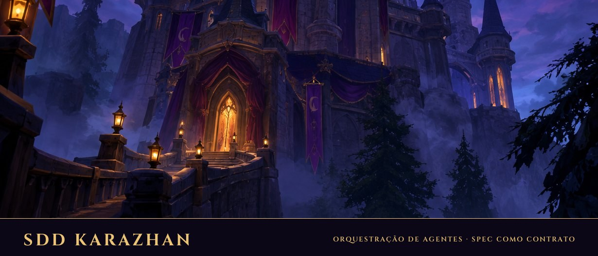

<p align="center">
  
</p>

# sdd-karazhan

**Spec primeiro. Time mínimo. Codex julga o Claude.**

Plugin do Claude Code para orquestrar agentes no [Maestri](https://maestri.dev). Mais magro e mais calibrado.

> Status: em construção. O design está em [`docs/superpowers/specs/`](docs/superpowers/specs/). Nada de código ainda.

---

## A ideia, em quatro frases

1. Arquiteto escreve contrato. Engineer cumpre contrato. Ninguém implementa sem contrato.
2. Um Engineer, um worktree, um dono por arquivo. Hook impede o resto.
3. Quem escreve código é Claude. Quem julga é Codex. Sempre.
4. Convoca só quem a missão precisa. Script decide. Você aprova com uma palavra.

## Por que existe

O sdd-maestri funciona. Mas monta time grande para feature pequena, cria duas notas por agente, pergunta preset toda onda e redige painel à mão. Caro. Lento. Dava preguiça de chamar.

Aqui: script dimensiona, script cria notas, script gera painel, script sorteia nome. O Orchestrator só decide.

## Quem vem à festa

| Papel | Prefixo | Faz | Elenco |
|---|---|---|---|
| **Orchestrator** | `orch` | Rege. Não codifica. | Magos de Dalaran: `antonidas`, `jaina`, `aethas`, `khadgar`, `aegwynn`, `kelthuzad` |
| **Architect** | `arch` | Descoberta, `spec.md`, `plan.md`, aceite como teste. | Dragões: `alexstrasza`, `nozdormu`, `ysera`, `kalecgos`, `wrathion`, `ebyssian`, `vyranoth`, `merithra`, `krasus` |
| **Recon** | `rec` | Entra, mapeia o repo, sai. Subagente. | Batedores: `garona`, `valeera`, `mathias`, `shandris`, `nathanos`, `rexxar` |
| **Engineer** | `eng` | Implementa no worktree dele. **Claude Code.** | Linha de frente: `grom`, `saurfang`, `durotan`, `orgrim`, `cairne`, `baine`, `thrall`, `varian`, `muradin`, `magni`, `tyrande`, `malfurion`, `illidan` |
| **Reviewer** | `rev` | Roda teste, lê diff, aprova ou devolve. **Codex.** | Julgadores: `uther`, `tirion`, `turalyon`, `bolvar`, `liadrin`, `alleria`, `arthas` |
| **Git Manager** | `git` | Worktree, hook, commit, PR. Dono do git. | Goblins e gnomos: `gazlowe`, `gallywix`, `mekkatorque`, `thermaplugg`, `brann`, `sprocket` |

Nome no canvas: `prefixo-personagem`. `eng-grom` implementa. `rev-arthas` devolve a WP inteira por um defeito. `git-gazlowe` cobra barato.

Papel diz o trabalho. Nome dá identidade. Não precisa saber lore.

## Como usar

```
/sdd-karazhan adicionar filtro por empresa no relatório
```

O script lê o repo e mostra a folha de convocação:

```
Pedido: "adicionar filtro por empresa no relatório"
Sinais: módulos=1 (relatorio) · spec=não · mapa=ok · testes=sim · tipo=feature
Nível: Pequena
Terminais: eng-grom (claude) · rev-uther (codex)
Subagentes: arch-ysera (spec curta) · git-gazlowe
Não convocar: recon (mapa válido)
```

Você diz "vai". Pronto.

Já sabe quem quer? Chama pelo nome:

```
/sdd-karazhan arch eng git
```

Script não decide. Só valida. Nunca adiciona quem você não pediu.

## Três tamanhos

| Nível | Terminais | Quando |
|---|---|---|
| **Pequena** | Orchestrator · 1 Engineer · Reviewer | Ajuste. Coletor novo em repo conhecido. |
| **Média** | Orchestrator · 2–3 Engineers · Reviewer · Architect | Feature que toca 2–3 módulos. |
| **Grande** | Time completo | Raro. |

Mínimo é 3. Quem orquestra não implementa. Quem implementa não revisa. Dois pares de olhos, sempre.

## Regras que não se negociam

1. Um dono por path. Worktree por WP. Hook bloqueia o resto.
2. Git é só do Git Manager. `pre-commit` rejeita arquivo fora dos paths da WP.
3. Nada destrutivo ou externo sem você dizer sim. Merge, deploy, PR, deletar nó do canvas.
4. Handoff é por arquivo. Chat não é contrato.
5. Quem produz não aprova. Reviewer em Codex, em outro terminal, lendo diff.

## Scripts (o que não gasta token)

| Script | Faz |
|---|---|
| `convocar.sh` | Dimensiona o pedido. Imprime a folha. |
| `pick-name.sh eng` | Sorteia nome livre do elenco. |
| `scaffold.sh 003-slug` | Cria specs, tasks, notas. |
| `mapa-check.sh` | Mapa ainda vale? Idade e impressão digital da árvore. |
| `donos.sh 003-slug` | Arquivo no escopo sem dono? Lista. |
| `wp-check.sh WP-03` | Lint, pytest, `--dry-run` real, diff restrito aos paths, arquivo fora do path. |
| `painel.sh 003-slug` | Gera o painel do `tasks.md`. |
| `guard-install.sh` | Instala `.sdd-role` e `pre-commit` no worktree. |

## Fora do Maestri

Funciona. Com degradação explícita: papéis viram subagentes do Claude Code, Reviewer cai para Claude em preset diferente, guard de path vira só checagem de diff. A skill avisa na primeira linha.

## Instalar

```
/plugin marketplace add renanpchaves/sdd-karazhan
/plugin install sdd-karazhan
```

Requer `git` e `jq`. `maestri` para o modo completo. `codex` para o Reviewer.

## Créditos

- Referência para a criação deste plugin: [SDD-Maestri](https://github.com/AndreRenatoMenezes/SDD-Maestri), de Andre Renato Menezes, MIT. Metodologia, cinco regras e estrutura de specs vêm de lá.
- Nomes dos personagens: Warcraft, © Blizzard Entertainment. Uso nominal, sem afiliação.

MIT. Veja [LICENSE](LICENSE).
